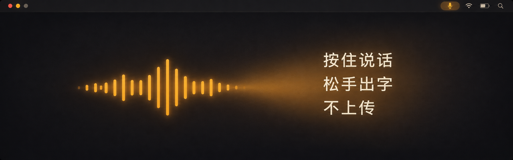
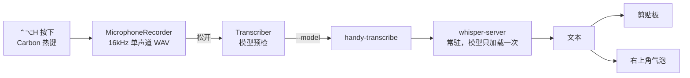

<p align="center">
  
</p>

<h1 align="center">Handy</h1>

<p align="center">
按住 <kbd>⌃</kbd><kbd>⌥</kbd><kbd>H</kbd> 说话，松手，文字进剪贴板。<br>
音频不出本机，不申请辅助功能权限，不监听键盘。
</p>

<p align="center">
  
  
  
  
</p>

---

## 为什么做这个

中文输入法打长句慢，云端语音输入要把录音传出去，输入法级方案要装输入法、还要全盘键盘权限。

Handy 只保留一个动作：**按住说话**。没有悬浮球、没有常驻窗口、不监听键盘事件、不模拟按键。

- 说 10 秒的话，比打 40 个字快
- 音频不出本机——会议内容、客户名字、代码片段都不上传
- 只申请麦克风一项权限

## 装

需要 macOS 13+、Xcode 命令行工具（`xcode-select --install`）。

```bash
brew install whisper-cpp                 # 提供 whisper-server / whisper-cli

git clone https://github.com/luogao/handy.git
cd handy

./scripts/fetch-model.sh                 # 下载 ggml-medium-q5_0（约 514MB）
./scripts/bundle.sh                      # 产出 build/Handy.app

cp -R build/Handy.app /Applications/ && open /Applications/Handy.app
```

第一次按 <kbd>⌃</kbd><kbd>⌥</kbd><kbd>H</kbd> 会弹麦克风授权，点允许即可。

> 想换模型（`large-v3-turbo` 等）：转成 ggml 放进 `~/.cache/whisper.cpp/`，
> 在「设置 › 模型」里选它。模型缺失和文件损坏会分别报不同的错，不会只丢一句「转写失败」。

## 用

| 动作 | 结果 |
|---|---|
| 按住 <kbd>⌃</kbd><kbd>⌥</kbd><kbd>H</kbd> 说话，松开 | 转写完成 → 写入剪贴板 + 右上角气泡 |
| 按得太短（< 0.2 秒） | 丢弃，不转写 |
| 说太久（> 60 秒） | 到点自动停，照常转写 |
| 点菜单栏图标 | 重试上次录音 / 设置 / 退出 |

「设置」里能改三样：热键、模型路径、日志开关。

**为什么只写剪贴板、不自动粘贴？** 自动粘贴要发合成按键事件，那就得申请辅助功能权限。
为了省一次 <kbd>⌘</kbd><kbd>V</kbd> 换一个全盘键盘权限，不划算。

## 它明确不做的事

| 不做 | 原因 |
|---|---|
| 上传音频 | 没有网络请求，转写全在本地 `whisper-server` |
| 监听键盘 / 模拟按键 | 不申请辅助功能、输入监控、Accessibility |
| 常驻 Dock / 悬浮窗 | 只有菜单栏图标 |
| 自动更新 | 现在升级就是重新 `bundle.sh` 覆盖 |

热键走 Carbon 的 `RegisterEventHotKey`——这是目前唯一能做到「全局热键 + 零 TCC」的路径。

## 性能（M 系列，medium-q5，本机实测）

| 音频长度 | 热态总耗时 |
|---|---|
| 3.2 秒 | 0.82 秒 |
| 21.9 秒 | 1.53 秒（3 次中位） |

热态 = `whisper-server` 已在跑、模型常驻内存。冷态首句会多一次模型加载（约 0.75 秒）。
`./handy-transcribe --log-stats` 能看到每次 spawn / ready / request 的明细。

设计上 **≤ 28 秒整段一次请求**：whisper 的硬窗口是 30 秒，31 秒单请求会丢后半段；
切段每多一次请求就多付一次编码开销，所以能不切就不切。

## 架构



- **`Handy.app`**：菜单栏 app，管热键、录音、气泡、设置
- **`handy-transcribe`**：转写引擎，默认复用常驻 server；`--no-server` 走一次性 `whisper-cli`
- **模型预检**：起进程之前先查文件，缺失与损坏分别有独立文案和日志码
  （`model_missing` / `model_unreadable`），4KB 垃圾文件不会被送进 whisper

更多调参细节（分段策略、热词 prompt、greedy 对齐、CER 口径）见
[docs/ENGINEERING.md](docs/ENGINEERING.md)。

## 附带的小工具

这些是 app 的基础件，也能单独用：

```bash
./handy-transcribe 录音.wav                      # 转写，打印到 stdout
./handy-transcribe 录音.wav --clip               # 再写剪贴板 + 弹气泡
./handy-transcribe --server-status               # server 是否在跑
./handy-transcribe --log-stats --since 24h       # 冷启动 / 就绪统计
./handy-mic --record 3                           # 录 3 秒到 WAV
./handy-clip "文本"                              # 写剪贴板（先备份原内容）
./handy-clip --restore                           # 还原剪贴板
./handy-hint --trigger                           # 只弹气泡，不碰剪贴板
```

## 开发

```bash
swift build
swift test           # 56 条：模型预检、失败文案、热键组合、日志解析等纯逻辑
./scripts/bundle.sh  # 打包，会把 handy-transcribe 一起编译进 Resources/bin
```

改失败路径或验收文案时用这两个脚本：

```bash
./scripts/failrepro.sh status          # 看当前状态
./scripts/failrepro.sh model-missing   # 造模型缺失（写 defaults，不动机器上的真模型）
./scripts/failrepro.sh model-corrupt   # 造模型损坏
./scripts/failrepro.sh restore         # 还原（按快照写回你原来的配置）
```

> `failrepro.sh` 改任何配置前都先快照原值，`restore` 按快照还原；
> 如果你自己手动改过，它会拒绝覆盖并打印三方对比。

## 已知限制

- 只在 macOS 13+ 验证；没做签名和公证，本地构建的 ad-hoc 签名可以直接开
- 中文识别最准（默认模型对中文优化过），英文 / 日文能用但没专项调
- 长音频（> 60 秒）会被截断——这是产品约束不是 bug
- 没有 Homebrew Cask、没有自动更新，升级靠重新构建

## License

[MIT](LICENSE)
